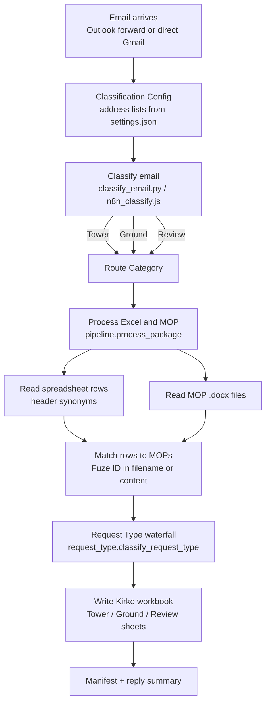
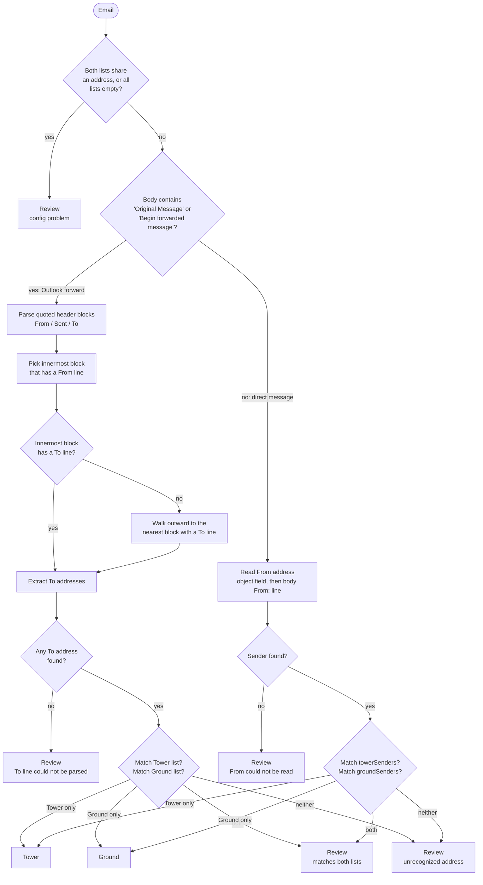
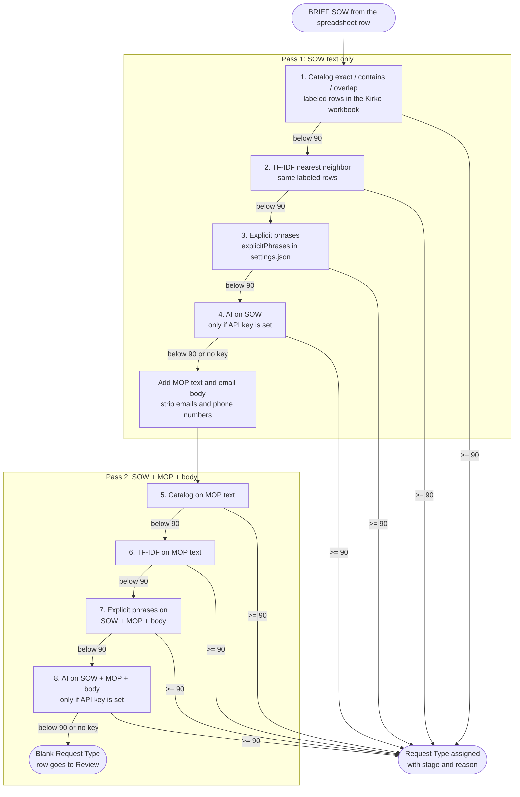

# Sample File Processing

Rule-based processing for Kirke schedule request emails. The pipeline reads an
email, decides whether it is **Tower**, **Ground**, or needs human **Review**,
then reads the attached schedule spreadsheet and MOP documents, assigns a
**Request Type**, and writes rows into the Kirke output workbook.

Every decision is made by deterministic rules that a person maintains in
`config/settings.json` and in the labeled rows of the Kirke workbook. An AI
model is used only as the last fallback for Request Type, and only when an API
key is configured. Without a key, the pipeline never calls AI.

## Contents

- [End-to-end flow](#end-to-end-flow)
- [Stage 1: Tower / Ground / Review classification](#stage-1-tower--ground--review-classification)
- [Stage 2: Request Type waterfall](#stage-2-request-type-waterfall)
- [Worked examples](#worked-examples)
- [Configuration](#configuration)
- [Running it](#running-it)
- [Where the rules live](#where-the-rules-live)

## End-to-end flow



The n8n workflow in `workflow/outlook-mop-automation.json` wires the same
steps: **Manual Trigger → Classification Config → Classify Forwarded Email →
Route Category → Process Excel and MOP**. The Code node runs
`processor/n8n_classify.js`, which is a line-for-line port of
`processor/classify_email.py`. The Execute Command node runs the Python CLI.

## Stage 1: Tower / Ground / Review classification

Stage 1 answers one question: **which address identifies this request?** It
never looks at the meaning of the text. It only extracts email addresses with a
regular expression and checks them against four lists in `config/settings.json`:

| List | Used when | Compared against |
| --- | --- | --- |
| `towerRecipients` | Outlook forward | addresses on the inner **To:** line |
| `groundRecipients` | Outlook forward | addresses on the inner **To:** line |
| `towerSenders` | Direct message | the **From** address |
| `groundSenders` | Direct message | the **From** address |



Details worth knowing:

- **Innermost block wins.** A double forward has two or three header blocks.
  The classifier uses the block closest to the original sender, not the hop
  that forwarded it to you. If that block has no To line it walks outward one
  block at a time. The result records which block was used in `toSource`
  (`innermost`, `outer_block_1`, `from`, or `ai`).
- **HTML bodies are flattened first.** `<br>`, `</p>`, `</div>`, `</tr>` and
  friends become newlines, tags are stripped, entities are decoded.
- **Folded header lines are joined.** A To line that wraps onto an indented
  continuation line is read as one line.
- **The only AI hook.** For a forward whose To line cannot be parsed, a caller
  may pass an `ai_extract` function. Any address it proposes is accepted only
  if that exact address already appears in the body text. The CLI and the n8n
  Code node do not pass one, so this branch goes to Review in practice.
- **Every Review result carries a reason** such as
  `Unrecognized sender: someone@random.com` or
  `Address is configured on both lists: ...`, so the person reviewing knows
  which rule stopped it.

## Stage 2: Request Type waterfall

Stage 2 runs once per spreadsheet row inside `process_package`. It picks one of
the allowed types for the category, for example `SNAP`, `OVP`, `Powershift` for
Tower or `Battery Replacement`, `Ground Prep`, `PDU` for Ground. The list of
allowed types per category is `requestTypes` in `config/settings.json`.

The same diagram is kept as a standalone file: Mermaid source in
`docs/request_type_waterfall.mmd` and a rendered copy in
`docs/request_type_waterfall.svg`. Regenerate the SVG after editing the
source with `npx @mermaid-js/mermaid-cli -i docs/request_type_waterfall.mmd -o docs/request_type_waterfall.svg`.



The waterfall stops at the **first stage that reaches the minimum confidence**
(`requestTypeMinConfidence`, default **90**). If no stage reaches it, the type
is left blank and the row is written to the Review sheet with the reason.



### How each stage scores

**Catalog match** (`processor/sow_catalog.py`). The Tower and Ground sheets of
the Kirke workbook are read as labeled examples: column A is the Request Type,
column C is the SOW text. Both the examples and the incoming SOW are normalized
to lowercase letters and digits, with a known typo `uapdf` folded to `uadpf`.

| Rule | Confidence |
| --- | --- |
| Normalized text is identical to a catalog row | 98 |
| Incoming SOW fully contains a catalog row of 8+ words | 95 |
| Word overlap score (75% containment + 25% Jaccard) of at least 0.84, 8+ shared words, no rival type within 0.10 | 90 to 94 |

If the matching rows disagree on type, the stage returns nothing rather than
guessing.

**TF-IDF nearest neighbor** (`processor/sow_model.py`). The same labeled rows
are turned into TF-IDF vectors in plain Python. The incoming SOW is compared by
cosine similarity to the best row of each type. Confidence depends on how
similar the best row is and how far ahead it is of the runner-up:

| Best similarity | Gap to second type | Confidence |
| --- | --- | --- |
| at least 0.72 | at least 0.08 | 88 + 12 x similarity, capped at 99 |
| at least 0.58 | at least 0.15 | similarity x 100, capped at 94 |
| anything else | | similarity x 80, capped at 89 (never assigned) |

**Explicit phrases** (`processor/request_type.py`). `explicitPhrases` maps each
type to literal trigger phrases. Multi-word phrases are substring matches;
single words match on word boundaries. If phrases for exactly one allowed type
are present the type is assigned at **95**. If two or more types match, the
stage returns 40 so the row is not assigned. Phrases are checked in the order
listed, so more specific labels such as `SNAP w/ Mount Mod` are listed before
`SNAP`.

**AI** (`processor/request_type.py`, `_ai_classify`). Runs only when
`MOP_AI_API_KEY` or `OPENAI_API_KEY` is set. It must return one of the allowed
types or an empty string; any other label is discarded and scored 0.

### Why the order matters

The stages are ordered from most trustworthy to least. A row that exactly
matches something a person already labeled in the workbook should never be
overridden by a phrase match, and a phrase match should never be overridden by
AI. Running the labeled data first also means the system improves as the
workbook grows, with no retraining step: the catalog and model are rebuilt from
the workbook each run and cached by file modification time.

## Worked examples

All outputs below were produced by running the code in this repository.

### Example 1: Outlook forward to the Tower mailbox

Input body:

```text
FYI - please process this one.

-----Original Message-----
From: Jane GC <jane.gc@vendor.com>
Sent: Tuesday, October 20, 2026 8:14 AM
To: Tower MOP <tower-mop@example.com>
Cc: Ops Team <ops@vendor.com>
Subject: GILLETT - Kirke Schedule Request 10.22.26

Hi team,

Please find the schedule request and MOP for GILLETT attached.
Scope: BBU swap for the SNAP, Day 2.
```

Command:

```bash
python -m processor classify-email --email-id fwd-001 --body-file forward.txt \
  --tower tower-mop@example.com --ground ground-mop@example.com
```

Result (body omitted):

```json
{
  "emailId": "fwd-001",
  "originalFrom": "jane.gc@vendor.com",
  "originalDate": "Tuesday, October 20, 2026 8:14 AM",
  "originalTo": "tower-mop@example.com",
  "toSource": "innermost",
  "category": "Tower",
  "reason": "Matched Tower recipient tower-mop@example.com",
  "status": "classified"
}
```

What happened: the body contains `-----Original Message-----`, so it is treated
as a forward. The one header block has a From line, so it is the innermost
block. Its To line yields `tower-mop@example.com`, which is on the Tower list
and not on the Ground list. The Cc address is ignored. The original sender and
date are carried along for the output workbook.

### Example 2: Direct message from a configured Ground sender

Command:

```bash
python -m processor classify-email --email-id gm-002 \
  --from "Kirke Ground <ctx_ground_kirke@yahoo.com>" --body-file direct.txt
```

Result:

```json
{
  "emailId": "gm-002",
  "originalFrom": "ctx_ground_kirke@yahoo.com",
  "toSource": "from",
  "category": "Ground",
  "reason": "Matched Ground sender ctx_ground_kirke@yahoo.com",
  "status": "classified"
}
```

What happened: no forward marker, so the From address is used. It matches
`groundSenders` in `config/settings.json`.

### Example 3: Direct message from an unknown sender

```bash
python -m processor classify-email --email-id gm-003 \
  --from "someone@random.com" --body-file direct.txt
```

```json
{
  "emailId": "gm-003",
  "originalFrom": "someone@random.com",
  "category": "Review",
  "reason": "Unrecognized sender: someone@random.com",
  "status": "review_required"
}
```

What happened: the address is on neither sender list, so the email is routed
to Review with the address named in the reason. Nothing is guessed from the
body text.

### Example 4: Request Type waterfall

Running `classify_request_type` with the shipped `config/settings.json` and no
AI key:

| Category | SOW | MOP text | Result | Stage | Reason |
| --- | --- | --- | --- | --- | --- |
| Tower | `BBU swap for the SNAP, Day 2` | | **SNAP** (95) | `explicit_sow_only` | Matched phrase `bbu swap for the snap` |
| Ground | `Battery replacement at the ground cabinet` | | **Battery Replacement** (95) | `explicit_sow_only` | Matched phrase `battery replacement` |
| Tower | `Site visit, see MOP` | `Tower Work: install OVP and swap indoor OVP ...` | **OVP** (95) | `explicit_sow_mop_body` | Matched phrase `swap indoor ovp` |
| Tower | `PDU upgrade and powershift` | | **Powershift** (95) | `explicit_sow_only` | Matched phrase `powershift` |
| Ground | `General maintenance` | `Check cabinet` | blank (0) | `unresolved` | No allowed Request Type was clear enough to assign |

Notes on these rows:

- Row 3 shows pass 2. The SOW alone matched nothing, so the MOP text was added
  and the OVP phrase was found there.
- Row 4 shows that phrases are literal. The Tower phrases for `PDU/Powershift`
  are `pdu/powershift` and `pdu powershift`; the text `PDU upgrade and
  powershift` matches neither, so only `powershift` fires and the row is typed
  `Powershift`. Add `pdu upgrade` to the `PDU/Powershift` phrase list if that
  wording should map there instead.
- Row 5 shows the safe default. Nothing matched, so the type is blank and the
  row is written to the Review sheet.
- The catalog and TF-IDF stages returned nothing in these runs because the
  Kirke workbook named in `catalogPath` is not present in this checkout. Place
  the workbook at the repository root and those stages run first.

## Configuration

All rules live in `config/settings.json`.

| Key | Purpose |
| --- | --- |
| `towerRecipients`, `groundRecipients` | Inner To addresses that identify a forwarded Tower or Ground request |
| `towerSenders`, `groundSenders` | From addresses that identify a direct Tower or Ground request |
| `requestTypes` | Allowed Request Types per category |
| `explicitPhrases` | Ordered list of `[type, [phrases]]` per category |
| `requestTypeMinConfidence` | Minimum confidence a stage must reach, default 90 |
| `catalogPath` | Workbook whose Tower and Ground sheets are the labeled examples |
| `templatePath`, `outputDir` | Where the Kirke output workbook is built |
| `headerSynonyms` | Alternate column headers accepted in the schedule spreadsheet |
| `matchStrategy` | How MOP files are matched to rows: `filename`, `content`, or `both` |
| `briefSowWordLimit` | SOW longer than this needs an AI summary or is flagged |

AI is enabled only by environment variables: `MOP_AI_API_KEY` (or
`OPENAI_API_KEY`), optional `MOP_AI_BASE_URL`, optional `MOP_AI_MODEL`.

## Running it

```bash
pip install -r requirements.txt

# Stage 1 on a saved email body
python -m processor classify-email --body-file email.txt --from "sender@example.com"

# Stage 2 against the Excel-trained model only
python -m processor classify-sow --category Tower --text "BBU swap for the SNAP"

# Full package: spreadsheet + MOPs -> Kirke workbook
python -m processor process --email-id abc --category Tower \
  --original-from jane.gc@vendor.com --original-date "Tuesday, October 20, 2026 8:14 AM" \
  --spreadsheet "GILLETT - Kirke Schedule Request 10.22.26.xlsx" --mop "GILLETT - MOP DAY 2.docx"

# Sample jobs from settings.json
python -m processor run-samples

# Tests
python -m pytest -q
```

## Where the rules live

| File | Role |
| --- | --- |
| `processor/classify_email.py` | Stage 1 in Python |
| `processor/n8n_classify.js` | Stage 1 as an n8n Code node, same logic |
| `processor/request_type.py` | Stage 2 waterfall and the optional AI calls |
| `processor/sow_catalog.py` | Catalog exact / contains / overlap matching |
| `processor/sow_model.py` | TF-IDF nearest neighbor model |
| `processor/pipeline.py` | Reads attachments, matches MOPs, calls Stage 2, writes output |
| `processor/export_kirke.py` | Kirke workbook writer, MOP naming, manifest |
| `workflow/outlook-mop-automation.json` | n8n workflow that chains the steps |
| `config/settings.json` | Every list, phrase, and threshold |
| `docs/request_type_waterfall.mmd` | Standalone Mermaid source for the Stage 2 waterfall |
| `docs/request_type_waterfall.svg` | Rendered copy of the waterfall diagram |
